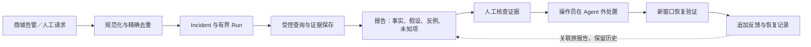
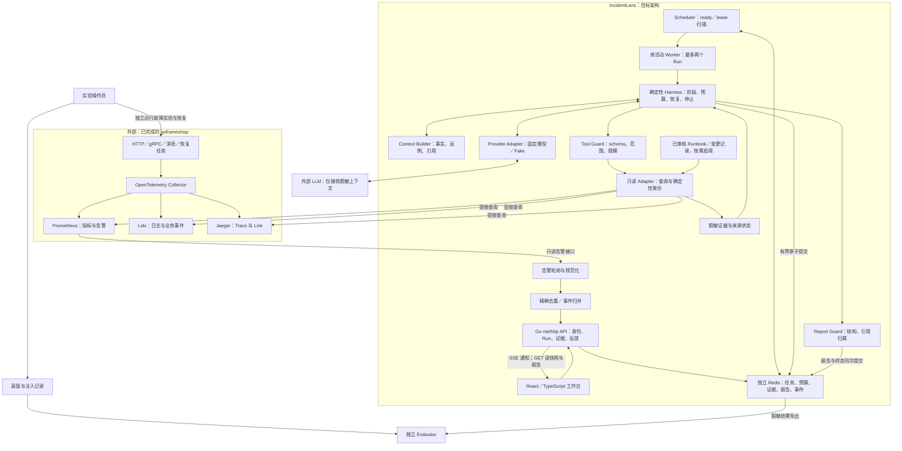
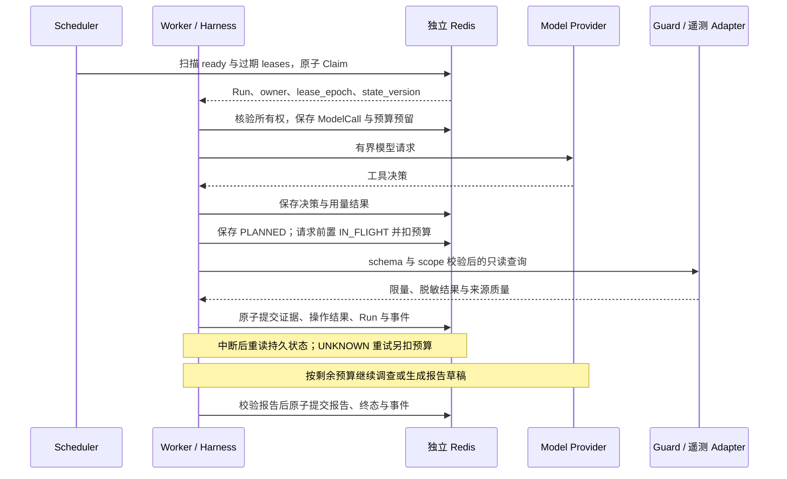

# IncidentLens｜日志诊断 Agent 整体架构与选型设计

> 更新：2026-10-31；状态：**目标设计，内核与模型调用边界已实现，真实效果与持久化待验收/实现**。  
> 本文替代 2026-09-07 原稿，是产品范围、整体架构与选型理由的主入口。当前已实现健康检查 API、三源查询 CLI、匿名快照回放与脚本驱动的离线调查内核；模型 HTTP 调用与内存预算已增加，Redis 原子状态、Harness checkpoint 与 Worker 已接线，真实供应商联调、在线持久调查和工作台待验收/实现，见 [README](README.md)。  
> [简历目标稿](04-IncidentLens简历目标稿.md) · [文档索引](docs/index.md) · [执行与恢复协议](docs/architecture/investigation-design.md) · [当前任务](tasks/0005-model-boundary.md)

## 1. 项目要解决什么问题

面向商城开发者与排障人员：订单异常往往跨越 RPC、库存预留、支付回调、异步消息和恢复任务。一个订单报错可能已被重试恢复，也可能只是下游故障的传播症状。人工需要在指标、Trace、日志间反复切换，判断影响范围、可能原因与当前是否仍异常。

IncidentLens 把一次调查变成有边界、可回查、可中断恢复的任务。模型按已有证据选择下一步查询；程序控制权限、预算、持久化和停止条件；最终交付带证据的诊断报告，由人核查、在系统外处置和验证恢复。

**价值假设：**减少排障信息整理与跨源检索工作，同时保留人工判断依据。只有完成同条件的人工对照，才能写“缩短人工排障时间”；模型耗时或 Token 下降不能代替业务收益。当前无上线用户数据、准确率或成本成绩。

### 已有基础与待实现范围

| 部分 | 当前事实 | 本项目承担的工作 |
| --- | --- | --- |
| GoFrame 商城 | 用户已完成；固定提交的交易、遥测、故障实验源码已核对 | 接入已有系统，不重建小型商城 |
| Agent 工程 | Go 1.25.0、net/http 健康检查；已增加只读查询 CLI、匿名 Bundle 和回放 | 实现模型调查、报告、恢复和工作台 |
| 商城遥测 | 三源历史查询已验证；日志自由文本当前省略 | 完成固定版本故障案例接入与安全字段覆盖 |
| 诊断数据集 | 已保存真实普通读取样本；固定版本故障 Fixture 尚未验收 | 采集故障对照、隔离真值、确定可诊断粒度 |
| Redis／前端／模型 | 模型 HTTP Adapter 与内存预算已实现；其余待实现/验收 | 独立持久 Redis、React/SSE、供应商兼容与效果验收 |

商城基线固定为 `385d3649b4f38f1db82e65aade57b00e10badb02`，依据见[代码基线](docs/integration/goframeshop-baseline.md)。源码核对不等于本地运行验收；商城测试通过不等于 Agent 诊断有效。

首版仅查询登记环境中的 `gateway-h5`、`order-service`、`goods-service`、`user-service`、`payment-simulator`。不执行 Shell/SQL、重启、退款、业务补偿、配置修改或故障注入。旧小型实验场与自研 KV 规划已废弃。

## 2. 产品闭环与状态边界

Incident 表示一次告警事件及其处理记录，Run 表示一次有限预算的调查。一个 Incident 可有多个显式发起的 Run，但不能通过自动重开 Run 绕过预算。

必须区分：告警是否仍 firing、调查是否 COMPLETED、报告是否 DIAGNOSED、人工是否确认恢复。这四种状态不能互相代替。报告完成后系统仍可能异常；告警消失也可能是数据源失联。

首版恢复验证由人工显式创建 `purpose=verification` 的新 Run，关联原报告并冻结新的观察窗口，保存所比较的指标、负载条件、同期变更和缺失信号。旧证据、原报告保持不变；反馈只追加。单次恢复迹象不足以证明处置动作是唯一原因。

## 3. 整体架构图

图中商城与遥测栈是已核对的外部基础。IncidentLens 已实现健康检查、三源查询/快照和离线内存 Run 子集，通过独立 CLI 使用；模型 HTTP 调用边界已实现但真实联调待验收；持久化和工作台链路仍待实现。目标 API 与 Worker 是两个进程入口，属于同一 Go 工程；模块框不代表额外微服务。

模型不直接访问数据源和 Redis，只提出工具调用或报告草稿。Evaluator 可读取隐藏真值，Investigator 无此权限。Agent 只覆盖遥测读取，不持有商城数据库或管理接口凭据。

## 4. 选型理由与代价

| 决定 | 解决的问题与选择理由 | 代价、边界与重新评估条件 |
| --- | --- | --- |
| Go＋现有 net/http；手工构造注入 | 复用现有工程，将注意力放在协议、取消与恢复；不因商城采用 GoFrame 而迁移 Agent | 路由、校验、鉴权需明确实现；出现实际维护收益再评估框架 |
| 单 Investigator＋确定性 Harness | 同一症状可能需要不同查询；将模型判断与程序权限、状态分开，便于审计和故障测试 | 动态调查收益尚待证明；固定 Workflow 始终作为对照 |
| 小型 Provider Adapter＋一个固定真实模型 | 隔离结构化调用和用量差异，用 Fake Provider 验证程序路径 | 不宣称通用兼容；第二模型先通过 schema、取消、usage、超时契约测试 |
| 复用 Prometheus／Loki／Jaeger | 商城已有三类互补信号，避免再做采集平台 | 采样、字段和保留期限制诊断；在线查询必须实测 |
| 结构字段聚合＋按需展开 | 利用 service、event、error 和业务 ID，减少重复日志进入模型 | 聚合可能隐藏反例；保留原记录引用、缺失信息及消融对照 |
| 独立 Redis 单实例 | 有界状态、条件更新、租约索引和事件回放可放在同一原子边界 | AOF everysec 支持本项目声明的 Worker 恢复目标；主机／Redis 故障不保证零丢失 |
| React＋TypeScript＋SSE | 工作台主要接收进度，单向事件足够；报告通过 GET 获取 | 需处理断线补读、快照序号和慢客户端；SSE 不保存唯一成果 |
| 版本化 Runbook／变更记录 | 少量领域知识可检索、可审计，暂不需要向量检索 | 源未建设时不启用；文档与变更关联不能直接证明因果 |
| 独立 Agent Docker Compose | 固定实验依赖、复用遥测端点、形成可复现演示 | 本地交付方案不宣称生产 HA；商城业务目前并非全部容器化 |
| 单活动 Worker、每 Run 顺序调用 | 控制恢复状态空间，便于解释预算与结果未知 | 初值最多两个并发 Run；不能推导大规模调度能力 |

**为什么暂不选 MySQL 保存 Agent 状态？**当前目标是短期、有界任务和证据，Redis 同时承载状态与回放事件，减少首版双写协议。若需要长期报告归档、复杂检索或更强事务持久性，应评估成熟关系数据库，而不是继续扩展 Redis 脚本或自研存储。商城已有 MySQL 不等于允许 Agent 接入业务库。

**为什么不增加 Kafka、Elasticsearch、文件采集器和多 Agent？**数据采集链已存在，瓶颈尚未证明在吞吐或检索容量；额外组件会扩大验收范围。只有独立子任务可并行、效果与成本对照证明收益时，再讨论多 Agent。

### 对参考项目的吸收范围

参考 [log-collect-ai-analytics 固定提交](https://github.com/jc2255/log-collect-ai-analytics/tree/757657da9904ab2823a5745e629bee441a9dd11b) 的产品结构，吸收规则筛选、重复告警管理与可回查页面的思路；查询聚合、证据快照与来源状态协议属于 IncidentLens 自己的设计。

该提交公开内容主要是文档、配置和预构建产物，不能据此验证其模型执行循环或 Checkpoint。其[后端构建文件](https://github.com/jc2255/log-collect-ai-analytics/blob/757657da9904ab2823a5745e629bee441a9dd11b/deploy/Dockerfile)复制已有二进制；[HA Compose](https://github.com/jc2255/log-collect-ai-analytics/blob/757657da9904ab2823a5745e629bee441a9dd11b/docker-compose.ha.yaml)与 README 的冗余描述不能直接等同。参考产品交互，不将未核验能力写入本项目。

## 5. 告警归并：先控制重复调查

商城没有 Alertmanager。自动入口计划轮询 Prometheus `/api/v1/alerts`，只接收 firing；短时实验使用明确标记的 manual 请求。详细字段见[告警契约](docs/telemetry/data-contract.md)。

- `fingerprint` 由来源、环境、告警名和规范化标签生成，保留 service、peer、step 等区别症状的标签，不仅按服务归并。
- `episode_id` 再加入 `activeAt` 区分重新激活；同 episode 重复轮询只更新 last_seen、观察次数和来源状态，复用现有活跃 Run。
- 同 episode 的 Run 已完成时，不因下一次轮询重新调查；需要新证据由用户显式新建 Run。新 episode 可按入口策略产生新 Incident，并受全局并发、速率与容量限制。
- `observation_count` 只表示轮询观察次数，不表示业务错误次数。手工提交用请求幂等键，不伪造 Prometheus episode。
- 不自动合并跨服务根因。拓扑和时间相关性仅展示“可能关联”；同服务不同告警保留独立事件。
- 来源失联或一次列表缺失不能确认恢复。记录“未观察到／来源未知”；恢复判断还需要可用遥测与明确窗口。

首版不依赖外部通知系统。以后若加入通知静默，静默只影响通知，不能跳过调查、隐藏事件或把事故标为恢复。

## 6. 调查路径与上下文治理

默认路径是“指标定位影响窗口 → 日志模式摘要／Trace 摘要 → 代表性 Trace → 关联日志 → 反例与恢复信号 → 报告”。它是查询优先策略，不是必经流水线：入口已有合法 Trace 时可直接展开；日志无 Trace 时允许使用 order_id、operation_id、event_id 关联。

新增目标工具 `summarize_log_patterns`：按已验证结构字段聚合日志，返回模式、观测条数、首次／末次时间、少量代表记录及可用 Trace/业务关联 ID，再用 `query_logs` 或 `get_trace` 展开。首版不引入通用日志模板挖掘、向量库或模型聚类。

| 必须保留的语义 | 原因 |
| --- | --- |
| 聚合范围、采样／截断、count_basis | 100 条样本中的出现次数不能写成整个事故发生次数 |
| 原记录引用、聚合版本、查询与采集时间 | 模型摘要不是证据；人工需要回查 |
| 正常／恢复记录与反例入口 | 只选最多错误日志会放大异常，漏掉已恢复状态 |
| 缺失 Trace、缺失字段、来源质量 | 查不到不代表不存在；缺失字段不能靠模型补齐 |

聚合与分页消耗同一后端请求预算，不能在一个工具内部无限查询。指纹记录规范化范围、过滤条件和模板版本；重启后继续约束重复查询。上下文保留事实、反例、未知项与 Evidence ID，最近工具摘要仅用于导航。

## 7. 来源状态、证据报告与工作台

来源可达、查询成功、结果为空、数据新鲜度和覆盖完整度是不同事实。ToolResult 除 AVAILABLE／EMPTY／UNAVAILABLE／PARTIAL 外，记录独立质量字段。HTTP 200 不等于业务正常；最新日志较旧也不必然代表采集坏了，没有可信新鲜度信号时标 UNKNOWN。

工作台主路径是“报告断言 → Evidence ID → 当时保存的脱敏快照 → 对应源查询信息”。重新查询是新的读取，必须重新鉴权、限制成本并保存独立审计记录，标明新的采集时间；不能覆盖报告引用的旧证据。首版重查统一通过显式创建新 Run 执行；新结果与历史快照并排展示。

报告分开保存影响范围、时间线、事实、主假设、备选解释、反例、未知项、下一步检查、是否仍异常及该判断的时间窗。Guard 校验结构与引用归属；人工评测判断证据是否支持结论。有效 Evidence ID 不能证明根因正确。

商城接入有四个直接影响诊断的限制：

1. `trade_db_acquire_timeout_total` 实际计数连接等待，不能解释成超时或连接泄漏。
2. `trade_workflow_backlog` 是数据库待处理工作数，不能写成 RabbitMQ 队列深度。
3. Loki body 是 message，业务字段来自属性；不能假设它是完整 stdout JSON。
4. 延迟消息与恢复任务可能形成新 Trace／Link，不能强制串成父子树。

完整字段及源码见[遥测契约](docs/telemetry/data-contract.md)。诊断边界必须随证据收缩，不能为了匹配故障答案补造信号。

## 8. 执行、预算与恢复架构

图中表示一次成功查询轮次；取消、失租、截止和结果未知走[执行协议](docs/architecture/investigation-design.md)中的分支。模型最终草稿须经过 Report Guard，不能直接改变 Run 终态。

实验预算初值为 12 次模型决策、16 次实际后端请求、24,000 输入＋输出 Token、从创建起 180s；为报告保留一次决策及合计 3,000 输入＋输出 Token。分页、重试、格式错误和结果未知按协议计入预算，恢复不重置 deadline。

独立 Redis 配置目标为 AOF everysec、noeviction，不能复用商城关闭持久化的缓存实例。owner＋lease_epoch 拒绝旧 Worker，业务 state_version 用于提交版本检查；续租不推进业务版本。调度器扫描待执行和租约过期索引，否则仅有 Checkpoint 也不能找回任务。

一次有界提交保存证据、工具结果、状态和事件；终态报告与完成状态一起保存。已提交但回包丢失时按 op_id／attempt 读回；外部结果未知才允许有界重查。不保证外部工具 Exactly Once 或避免所有模型重复计费。

首版只验证 Worker 进程中断，Redis／主机故障后的持久性不做零丢失承诺。终态数据保留 7 天，每 Run 证据 2MiB、事件 500 条、报告 64KiB，均为待验证初值。长期归档不在此保证内。

## 9. 如何证明项目有效

| 验证层 | 证明什么 | 不证明什么 |
| --- | --- | --- |
| Fake Provider＋Fixture＋可控时钟 | 权限、预算、停止、取消和恢复按协议执行 | 真实模型诊断准确 |
| 固定真实模型＋冻结遥测＋隐藏真值 | 根因命中、证据支持、拒答、成本及上下文消融 | 生产总体效果 |
| 真实商城端到端 | 数据到达、跨源查询、告警入口、工作台与反馈闭环 | 大规模并发、高可用或真实组织收益 |

同一输入比较 B0 固定规则、B1 固定查询＋同一模型、A 动态调查＋同一模型；资源上限一致，记录实际消耗。聚合单独做消融，同时报告 Token、证据支持率、根因命中和误拒答变化。告警去重另测并发提交、轮询重放、重新激活、不同症状与失联，不混入诊断准确率。

先采用商城已有实验中可由公开遥测支持的案例：预留结果未知后恢复、消息重投与去重、正常业务拒绝、证据不足。DB 耗尽、持续服务延迟、配置错误等需另建且核实，不把旧稿场景列表当成已存在数据集。

保存商城 SHA、样本哈希、模型与 Prompt／策略版本、次数、分子分母、失败原因。注入记录、测试标题和真值不进入工具与 Prompt。人类仅看同样证据也无法判断的原因，不强迫模型猜中。详见[评测方案](docs/evaluation/plan.md)。

## 10. 实施顺序与简历证据

| 切片 | 可交付成果 | 进入下一步的条件 |
| --- | --- | --- |
| 1. 任务 0002（故障样本待验收） | 三源只读 Adapter、真实脱敏 Fixture、人工证据报告 | 能解释数据来源、缺失与可诊断粒度 |
| 2. 最小调查 | 单 Investigator、Guard、确定性日志聚合、结构化报告 | 真实模型完成调查；固定 Workflow 可对照 |
| 3. 效果与约束 | 留出样本、上下文消融、拒答／注入评测 | 保存逐次结果与失败分析，不只给总准确率 |
| 4. 恢复与入口 | Redis、索引与预算、Worker 故障测试、告警归并 | 接管可发现、旧 Worker 拒写、预算守恒、重复告警不重复开 Run |
| 5. 工作台闭环 | SSE 回放、证据钻取、反馈、恢复验证、Compose 演示 | 中断后报告可读、快照可核查、人工完成一次闭环 |

按 2026-10-29 用户范围，任务 0003 已先交付脚本驱动的离线 Harness 子集；真实供应商联调与效果仍待验收。任务 0004 已实现单次日志样本的确定性聚合，任务 0005 已实现有界模型输入与内存 Token 核算，实际效果与持久恢复仍待验收。核心闭环先于通知渠道、第二模型与复杂检索。

[简历目标稿](04-IncidentLens简历目标稿.md)按 Harness、上下文、证据、恢复和工作台五条组织，每条对应本设计的验收证据。完成相应实现与实测后，才能改为完成表述并填真实指标。

## 11. 文档维护与关键追问

本文负责整体架构和理由；[调查设计](docs/architecture/investigation-design.md)负责状态、接口、预算和恢复；[遥测契约](docs/telemetry/data-contract.md)负责实际字段；[评测方案](docs/evaluation/plan.md)负责分母与真值。改变边界时同步对应专题和 [changelog](docs/changelog.md)，不维护互相独立的完整设计副本。

面试与评审应能用证据回答：

- 为什么动态 Agent 优于固定查询？用 B1/A 对照回答，允许实验不支持增益。
- 聚合漏掉少量关键反例怎么办？展示原记录回查、保留策略及消融失败案例。
- 引用了真实证据为何仍会错？区分结构校验与语义支持，用人工评分解释。
- Worker 查询成功后被杀会怎样？按持久提交边界说明 UNKNOWN、重查成本与预算。
- 为什么不承诺 Redis 零丢失？说明故障模型、AOF 配置、未覆盖的主机故障。
- 如何判断商城已恢复？使用新窗口、相同口径和负载背景，区分来源缺失与正常。
- 项目有什么业务价值？展示可回查闭环；效率收益另做人工对照，不靠框架数量证明。
